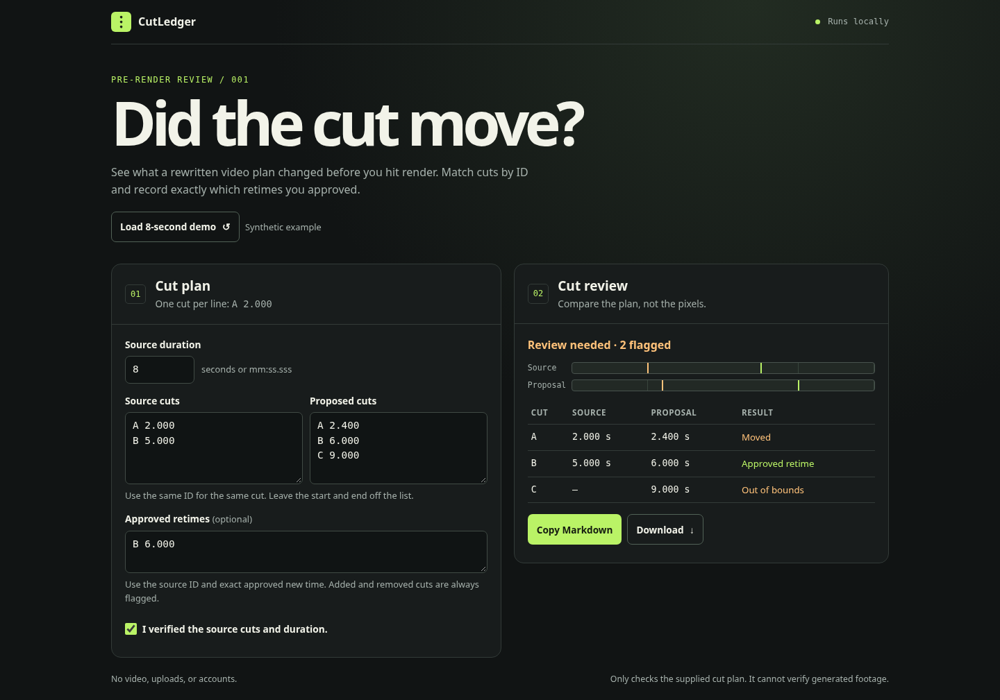

# CutLedger

**Did the cut move?** Verify a video's cut plan before you spend time rendering. Paste the cut times from an editor-verified source timeline and the matching IDs in a proposed plan; CutLedger points out what moved, disappeared, appeared, or ran past the duration. You can mark an exact retime as intentional. No footage, account, API key, or upload required.

[简体中文](#简体中文) · [8-second example](#8-second-example) · [Tests](#tests)



## Try it locally

1. On GitHub, select **Code → Download ZIP** or clone this repository.
2. Unzip if needed and open `index.html` in a current browser. No install, build, or server.
3. The page opens on a synthetic 8-second, three-shot example. Change the proposed cut times or add an approval and watch the result update.
4. Download the Markdown report; **Copy Markdown** also works when the browser permits clipboard access.

### 8-second example

| Field | Paste these lines |
| --- | --- |
| Source duration | `8` |
| **Source cuts** (internal boundaries only) | `A 2.000` then `B 5.000` |
| **Proposed cuts** | `A 2.400`, `B 6.000`, `C 9.000` on separate lines |
| **Approved retimes** | `B 6.000` |

Cut A moved without approval, B is an exact approved retime, and C falls outside the 8-second source. Removing B from the proposed list reports it as missing; adding C at 7 instead reports it as extra. Input order is irrelevant: IDs must stay attached to the same cut. IDs start with an ASCII letter and contain up to 24 ASCII letters/numbers/underscores/hyphens; they are case-sensitive. Use seconds (`2.500`) or `mm:ss.sss`, at up to millisecond precision, with no frame-rate rounding. Start and end are implicit; a blank cut list represents one uncut shot. Blank lines and lines beginning with `#` are ignored.

**Approval is narrow.** An approval requires an existing source ID, a new time strictly inside the source, and an exact match in the proposal. Removing, adding, and changing total duration are outside approval scope in this version. Changing source cuts or duration clears the verified checkbox and pauses existing approvals. Rechecking the source alone does not reapply them. Review the retained entries, then choose **Approve retimes for this source**. Editing only the proposal does not pause approvals. If the source hasn't been verified, the result is explicitly a draft, even if every proposed time matches.

## Scope and privacy

- This is a *preflight for lists of known cut boundaries*. It does not read a video, parse free-form prompts, guess which shot an ID refers to, handle variable runtimes, detect transition type, or verify footage produced by a rendering model.
- Inputs stay in the open page until you download or copy them. The app initiates no network requests for processing, uses no external scripts/fonts, stores no inputs, and has no telemetry. A hosting provider, if you deploy a copy, may still log normal page requests.
- The local tool only needs a browser. To host it yourself, serve the four static app files together (`index.html`, `style.css`, `core.js`, `app.js`).

## Tests

```sh
node --test tests/core.test.js
```

Optional real-browser smoke test (requires Python Playwright and Chromium, both test-only):

```sh
python -m playwright install chromium
python tests/browser_smoke.py
```

Use `CHROMIUM_PATH=/path/to/chromium` to use an existing executable. License: [MIT](LICENSE).

## 简体中文

**生成前核对分镜切点。** 如果你只想换角色，不用等渲染结束才发现切点也变了。CutLedger 比较原始切点和改写后的切点，指出移动、漏掉、新增和超范围的切点。已确认的改时只认可同一切点、同一目标时间。

1. 在 GitHub 下载 ZIP 并解压，用浏览器打开 `index.html`，无需安装。
2. 页面先显示一段 8 秒、3 个镜头的虚构示例。每行填一个 ID 和时间，如 `A 2.000`；两份列表用同一 ID 指代同一个切点。起点与终点不需要填。
3. 只有核对过原始时长和切点，才勾选确认框。修改原始切点或时长会取消来源确认，并暂停旧的改时批准。重新核对来源不会恢复旧批准；核对保留的改时条目后，再点击 **Approve retimes for this source**。仅修改提案不影响已有批准。可以下载 Markdown 报告或在浏览器允许时复制。

工具不会识别视频或解析整段提示词，也不验证生成画面的效果。待比对的时间由你提供；别把模型猜出的时间当参照。除导出或复制外，输入留在当前页面，不保存、不上传。浏览器直接打开即可使用；Node 和 Playwright 只用于跑测试。许可证：[MIT](LICENSE)。
